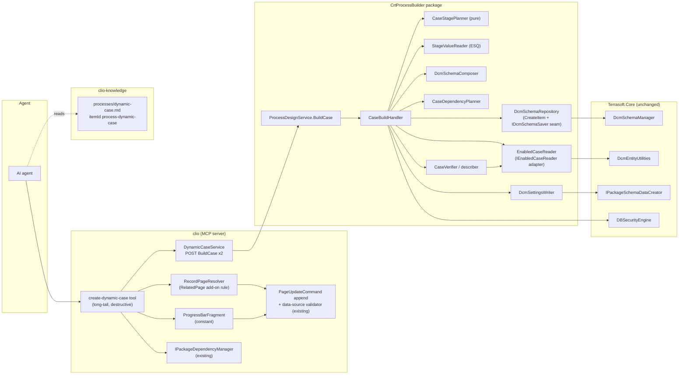
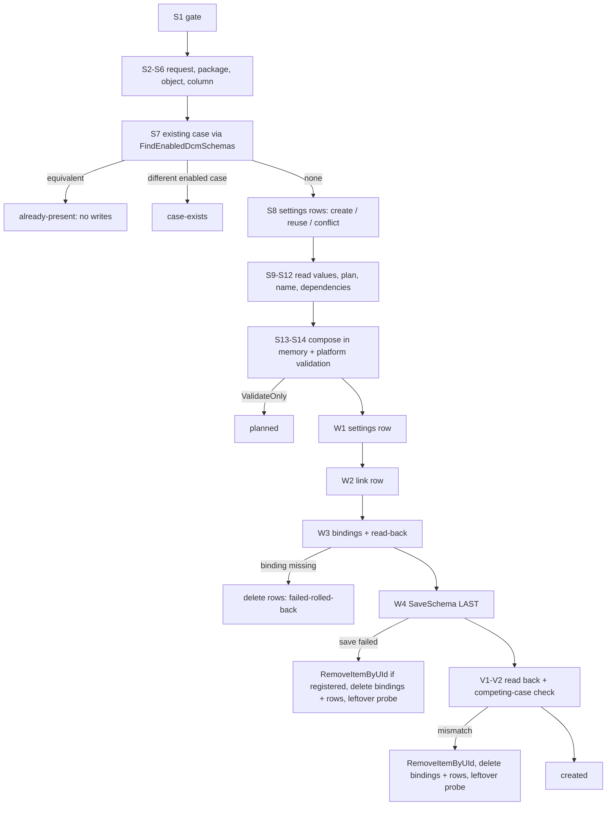

# ENG-105556 AI Toolkit: create a minimal DCM (stages from a lookup) and add a progress bar to the record page - chosen design

| | |
|---|---|
| Issue | ENG-105556 AI Toolkit: create a minimal DCM (stages from a lookup) and add a progress bar to the record page (Task; epic ENG-92704 Create BP via AI Toolkit) |
| Status | Proposal, 2026-11-08. NOTHING is agreed: every choice below that has an alternative is an open question in [eng-105556-minimal-dcm-decisions.md](eng-105556-minimal-dcm-decisions.md) (Q1..Q29); the text states the recommended option |
| How it was made | Judge's merge of three independent designs (A maximum reuse, B extensibility first, C risk first) in `<research-dir>/design-{a-reuse,b-extensible,c-risk}.md`, research notes r1..r10, g1..g6 and `_verdicts.md` (a verdict overrides its note). Where the designs disagreed on a fact, the source was re-read today; those reads are tagged `[traced, judge]` |
| Base | Design A (placement and reuse choices). Grafted: from C the write order, the post-save verification, the extra rights pre-check, the stage bounds, the "no BuildCase" mapping and the risk register; from B the describe-shaped response, the composer/repository split, the per-artifact obligations, the idempotent re-run on an equivalent case and the steps-factory plan for the later task. Score table: decisions file, appendix A |
| Baselines | CrtProcessBuilder `main` a3f58852 (1.6.6.140); clio `master` 69788ccd5; clio-knowledge `master` 622134b (libraryVersion 1.15.180); core TSBpm a95349820; creatio-ui 7ca9210bd0e; PackageStore `*/branches/7.8.0`; stand `Creatio` (.NET Framework, read-only) |
| Constraints honoured | Read-only research; costs argued clean-slate (the CrtGenAI saver and the 1.6.6.142 build on the stand are references, not sunk cost); only 8.x (Freedom UI) pages; core is not changed |

Evidence tags: `[traced path:line]` source read; `[traced, judge]` source re-read by the judge today to settle a
disagreement; `[corpus N/M]` count over packages; `[measured]` stand read (query in the cited note);
`[academy URL]`; `[note]` the owner's DCM overview; `[inferred]` reasoning. `(v r1-C8)` points at the row of
`_verdicts.md` that carries the full evidence list; `(r6 §2)`, `(g3)` point at a research note section.

Path aliases:

| Alias | Path |
|---|---|
| CORE | `<core>/Src/Lib/` |
| PB | `<crt-process-builder>/packages/CrtProcessBuilder/Files/src/cs/` |
| PBT | `<crt-process-builder>/tests/UnitTests/CrtProcessBuilder.Tests/` |
| CLIO | `<clio>/` |
| KB | `<clio-knowledge>/` |
| PS | `<PackageStore>/<Package>/branches/7.8.0/` |
| UI | `<creatio-ui>/` |

---

## 0. The design on one screen

1. **Core: no change.** A DCM is a process (`DcmSchema : BaseProcessSchema`) that is always interpreted: no C# is
   generated, so the DCM itself needs no compile and no restart on either runtime [traced CORE/Terrasoft.Core/DcmProcess/DcmSchema.cs:48]
   [note "A case is not a separate engine. It is a process"] (v r1-C1, v r4-C4, v r6-C2). Everything the task needs is
   public: `DcmSchemaManager.CreateSchema` / `SaveSchema` / `GetProcessValidationResult` / `RemoveItemByUId`, the
   `DcmSchema` / `DcmSchemaStage` / `DcmSchemaStageConnection` object model, `DcmEntityUtilities.FindEnabledDcmSchemas`,
   `IPackageSchemaDataCreator`, `PackageElementUtilities.DeletePackageSchemaData`, `DBSecurityEngine` checks (section 11).
2. **CrtProcessBuilder hosts the write** as ONE new operation `BuildCase` on the existing `ProcessDesignService`
   (Q1, Q2). In one request it gates rights, resolves the object, the lookup column and its values, plans the stages,
   writes the two settings rows and their package bindings, saves the DCM LAST, and reads everything back the way the
   progress bar will. It reuses the service transport, scope, unknown-key refusal, `SafeText`, notices, package
   resolution and the repository save seam, and ports about 55 lines of CrtGenAI `GeneratedDcmSaver`
   (GeneratedDcmSaver.cs:105-182) with its six known defects fixed (r4 §7, v r4-C2, v r4-C3). It is also where the later "steps inside stages" task finds the
   user-task and sub-process element handlers it must reuse (v r6-C5, v r6-C6).
3. **clio adds ONE long-tail MCP tool `create-dynamic-case`** (Q3, Q4): validate pass on the server -> record-page
   resolution, read-only page checks and an append DRY RUN through the existing `PageUpdateCommand` -> optional
   dependency add through the existing `IPackageDependencyManager` -> build pass (dependencies undone if it does not
   create the case) -> progress-bar append through the same `PageUpdateCommand`. One tool costs one line of the
   discovery index, which has room for exactly one (v r7-C4).
4. **The page edit is the AI app wizard's two inserts**: `ProgressBarContainer` (`crt.FlexContainer`) at index 0 of
   `MainContainer`, then `crt.EntityStageProgressBar` with `entityName`, `saveOnChange: true`,
   `askUserToChangeSchema: false`. Nothing else on the page (v r3-C1, v r3-C2, v r3-C8).
5. **Shape written** = the product's minimal shape: one stage per lookup value in the chosen order, fresh stage
   UIds, `StageRecordId` = lookup row Id, colour `#0C8701`, full-mesh `StageConnections` n*(n-1), `Enabled = true`,
   active version; plus `SysDcmSettings` (object form) and `SysDcmSchemaInSettings`, bound to the target package
   under the designer's naming (v r1-C3, v r2-C4, v r3-C5, v r4-C8, v r5-C6, v r5-C8; `_verdicts.md` conflicts 6-7)
   (Q14, Q15, Q29).
6. **Obligations are stated**: `compileRequired: false`, `restartRequired: false`, `reloadOpenPages: true`, per
   artifact. The knowledge-base sentence that says a DCM "carries its own compile obligations" is corrected
   [traced KB/guidance/mcp/guides/processes/process-modeling.md:157-158] (v r1-C1).
7. **.NET 8**: identical code path (no `#if` in `Terrasoft.Core/DcmProcess`), but NOT measured: no .NET 8 stand is
   reachable (g5 §1). "Done" requires the E2E fixture and the CAADT scenario on an owner-provisioned .NET 8 stand (Q24).
8. **Room for steps later**: stages travel as objects; composition, planning, saving and dependency planning are
   separate seams; the response is describe-shaped; obligations are per artifact (section 12).

---

## 1. Why this shape (judge's summary)

All three designs agree on the core architecture: no core change, the DCM write in CrtProcessBuilder, the page edit
in clio, one long-tail tool, the app-wizard fragment, route A save (`SaveSchema` over the object model, Q6), full mesh,
`#0C8701`, settings rows + bindings, no compile, one KB article. They differ in placement details, write order,
reuse of core helpers and policy choices. The resolutions:

| Disagreement | A | B | C | Resolution and evidence |
|---|---|---|---|---|
| Existing-case check | `DcmEntityUtilities.FindEnabledDcmSchemas` | own scan of `GetItems()` + `GetIsActiveVersion(item)` | own scan + `GetIsActiveVersion(item)` | **A.** `GetIsActiveVersion(ISchemaManagerItem)` is `internal`; only `GetIsActiveVersion(Guid schemaId)` is public [traced, judge CORE/Terrasoft.Core/Process/BaseProcessSchemaManager.cs:1262,1522]. `DcmEntityUtilities` is a public sealed class with a public ctor and a public `FindEnabledDcmSchemas` that applies the exact runtime predicate (root-item `Enabled` + active version + entity) [traced, judge CORE/Terrasoft.Core/DcmProcess/DcmEntityUtilities.cs:19,57,434-438,467-476]; its interface `IDcmEntityUtilities` is internal [traced, judge CORE/Terrasoft.Core/DcmProcess/IDcmEntityUtilities.cs:14], so the package calls the class. Reuse of core logic, as the owner asked |
| Write order | schema save, then rows, then bindings | same as A | rows, link row, bindings first; schema save LAST | **C.** The save's side effects (`ActualizeSchemaInfo`: start-event row via the system connection, flow schema to its own storage) are not rolled back by the platform (v r1-C2); whether `RemoveItemByUId` removes them is unmeasured (M5). Rows and bindings are plain, removable data: `SysDcmSchemaInSettings.SysDcmSchemaUId` is a plain Guid column, not a lookup, so the link row can precede the schema [traced, judge PS CrtBase/Schemas/SysDcmSchemaInSettings/metadata.json:21-28]; no server listener acts on the two tables [traced, judge grep PS */branches/7.8.0 *.cs and CORE: only GeneratedDcmSaver]; bindings are removable through public `PackageElementUtilities.DeletePackageSchemaData` [traced, judge CORE/Terrasoft.Core/Packages/PackageElementUtilities.cs:1685-1697]. Q7 |
| Rights gate | General + CanManageDcm + CanManageSolution | same | + append right on both settings tables | **C.** Settings-table rights grant "All employees" read only [traced, judge PS CrtBase/Data/SysEntitySchemaOperationRight_SysDcmSettings/data.json: three `false`, one `true`, grantee All employees]; the check API is public [traced, judge CORE/Terrasoft.Core/DB/DBSecurityEngine.cs:3707]. Cheap, closes a refusal-after-save. Q5 |
| Placement of `BuildCase` | op on `ProcessDesignService` | sibling `DcmDesignService` | op on `ProcessDesignService` | **A/C**, open (Q2). A sibling class would be served the same way (`[ServiceContract]` + `AspNetCompatibilityRequirements`) [traced, judge PB/EntryPoints/WebService/ProcessDesignService.cs:27-30], but its route is unmeasured (B's own O1) and it escapes the package mirror pin (v r7-C3). Either way clio's operation pin goes 8 -> 9 and a NEW gate-name pin is needed, because the gate pin counts only the literal `EnsureCanManageProcessDesign` [traced, judge CLIO/clio.tests/Common/BundledProcessBuilderPackageTests.cs:292,361,373,384] |
| Page write path | `PageUpdateCommand.TryUpdatePage` + data-source validator, under the tool's tenant lock | extract `IPageFragmentWriter` from `PageUpdateTool` | as A | **A/C**, open (Q18). The fragment is a clio constant, so the agent-body guards (AST lint, baseline guard, run-process-button check) do not apply; extraction would touch an 836-line tool [traced, judge CLIO/clio/Command/McpServer/Tools/PageUpdateTool.cs:29-31,132-141,239,531]. `InternalExecute<TCommand>` already holds `McpToolExecutionLock` for the tenant, and a C# `lock` is re-entrant on the same thread [traced, judge CLIO/clio/Command/McpServer/Tools/BaseTool.cs:216-238; PageEditToolHelpers.cs:22-35] |
| Missing package dependencies | server computes, clio adds | same, with opt-out flag | refuse with the exact calls | **B** (add, opt-out), open (Q16). g3 traced that the platform's own designer adds them on save and 61/61 shipped DCMs satisfy the closure; the set is computed exactly, not guessed (g3 "What the tool should do" 1-3) |
| Re-run on the same object | `case-exists` | equivalent case -> `already-present`, continue to page | `case-exists` | **B**, open (Q12): safe retry of the whole call after a page failure, writes nothing |
| `stages` subset | allowed with warning | not stated | must be a permutation | **C**, open (Q10): the ticket scope is "one stage per lookup value"; a subset is an additive later option |
| Lookup read | ESQ under user rights + pure in-memory sort | `Select` with ORDER BY | `Select` ORDER BY + ESQ for captions | **A**, open (Q9): the designer validates stage records under user rights (v r2-C5), so reading under user rights keeps every stage valid in the designer; the pure planner is testable without query mocks |
| Lookup bounds | 1..30 | 1..50, warn > 10 | 2..20 | **C**, open (Q11): one stage is the final stage and a final stage without steps ends the case at once [note "What happens on a stage change"] (r1 §8.2) |
| KB naming | file + itemId `dynamic-case` | file `process-dynamic-case.md` | file + itemId `dynamic-case` | **Neither literally.** Files under `processes/` carry no prefix, itemIds do: `send-email-attachments.md` is itemId `process-send-email-attachments` [traced, judge KB/bundle-source.json:141,345,1884]. So file `processes/dynamic-case.md`, itemId `process-dynamic-case` (Q23) |
| `CreateSchema` base | `DefSchema` | `DefSchema` | `null` | Same thing: a null base becomes `DefSchema`; `addToDesignItems=false` registers nothing [traced, judge CORE/Terrasoft.Core/SchemaManager.cs:3335-3355,5506-5515] |

---

## 2. Components per repository



| Piece | Repository | Why there | Rejected placement (clean-slate cost) |
|---|---|---|---|
| DCM object model, save, flow generation, start signal | core, unchanged | public, proven by `GeneratedDcmSaver` [traced PS CrtGenAI/Schemas/GeneratedDcmSaver/GeneratedDcmSaver.cs:123-158] (v r1-C4) | core API: core release train, unreachable on existing environments (all three designs) |
| Gate, request contract, lookup read + plan, dependency plan, settings rows + bindings, schema save, rollback, read-back. Two test seams: `IDcmSchemaRepository.CreateItem(name, uid)` (item creation lives in the repository, as `ProcessSchemaRepository.cs:65-68` does for processes) and `IEnabledCaseReader` (DI-registered adapter over the sealed `DcmEntityUtilities`, whose interface is internal and which calls the internal `GetIsActiveVersion(item)`) | CrtProcessBuilder, `BuildCase` | one `UserConnection`, one compensation scope, in-memory read-back of the manager (g1 (b)); the package already wraps `SchemaManager` saves with rollback, cache release and an error envelope [traced PB/Schema/ProcessSchemaRepository.cs:184,189,336,371]; the later steps task needs its element handlers (v r6-C6) | clio-only client of the designer endpoints: no rebundle, but clio must emit the undocumented design-JSON dialect (g2 §2), 4-6 non-atomic HTTP writes, and the steps task would duplicate the package's element handlers in clio; depending on CrtGenAI breaks `DependsOn []` and inherits six defects (v r4-C2) |
| Record-page resolution, page checks, fragment, page save | clio | clio owns get, append-merge (client-side `PageBodyMerger`), design-package resolution and validation (v r7-C6) | server-side page edit: duplicates the merge pipeline in a second language |
| Package dependency add | clio, existing `IPackageDependencyManager.AddDependencies` [traced CLIO/clio/Package/IPackageDependencyManager.cs:37] | the platform applier is internal; clio has a tested add path over `PackageService.svc/SavePackageProperties` (g3 §2) | re-implement the applier in the package over `PackageValidator` + `Package.AddDependency` |
| Guidance | clio-knowledge | the only home of guidance content (clio AGENTS.md "MCP maintenance policy") | tool description only: no budget, no routing |
| E2E object | SVN `AutoTestClioMcp` (Q25) | deployed on every ProcessDesigner-lane stand [measured g5 §2.1] | publish inside the fixture: forces the local tier |
| CAADT | `creatio-adaclio-testing` prompt + `creatio-playwright-tests` spec | the CAADT homes (r7 §7, g5 §5) | - |

---

## 3. MCP contract: `create-dynamic-case`

| Field | Value |
|---|---|
| Name | `create-dynamic-case` ("case" alone collides with the `Case` object; "dynamic case" is the Academy term) (Q4) |
| Kind | long-tail, called through `clio-run-destructive`; MCP-only, no CLI verb, like every process-designer tool (r7 §1.5) |
| Annotations | `ReadOnly=false`, `Destructive=true`, `Idempotent=true` if Q12 keeps the equivalent re-run as `already-present` (it writes nothing, section 9), else `false`; `OpenWorld=false` |
| Execution | `[McpToolExecution(Location=Worker, Lifetime=PerCall)]` as `CreateBusinessProcessTool` (CreateBusinessProcessTool.cs:364-366); environment-aware `BaseTool<TOptions>.InternalExecute<TCommand>` |
| Package gate | `[RequiresPackage("CrtProcessBuilder", "<first archive with BuildCase>")]` on the options type (v r7-C2), at a version above every deployed build (Q22) |
| Feature toggle | none: process-designer tools ship ungated; a toggle would also change the KB banner rule (v r7-C8) (Q28) |
| Index line | "Create a minimal dynamic case (DCM): one stage per value of an object's lookup column, plus the record-page stage progress bar." (one line; v r7-C4) |

### 3.1 Arguments (kebab-case wire keys)

| Key | Req. | Default | Meaning |
|---|---|---|---|
| `environment-name` | yes | - | target environment |
| `package-name` | yes | - | editable package P that receives the DCM and the two settings bindings |
| `entity-schema-name` | yes | - | object the case belongs to; its RUNTIME schema must have the column (publish first) |
| `stage-column-name` | yes | - | lookup column of that object; its values become the stages |
| `stages` | no | every lookup value in the default order (section 5, S10) | ordered list of `{"value": "<Id or exact display value>"}` (a bare string is normalised by clio); must name every lookup value exactly once (Q10) |
| `order-column` | no | auto | integer column of the lookup that orders the stages; ignored when `stages` is given |
| `name` | no | `<prefix><Object without prefix>Case`, first free numeric suffix | DCM code; an explicit name that is invalid or taken is refused, never suffixed (Q26) |
| `caption` | no | `<object caption> case` | DCM title, current culture |
| `add-progress-bar` | no | `true` | `false` writes the DCM only |
| `page-schema-name` | no | resolved (section 7.1) | Freedom UI web record page; required for typed page sets such as `Activity` (Q20) |
| `add-package-dependencies` | no | `true` | `false` turns a missing dependency into a refusal that lists the exact `add-package-dependency` calls (Q16) |
| `dry-run` | no | `false` | every check and the full plan; nothing written |

Argument handling copies `CreateBusinessProcessTool`: null-args refusal, unknown keys refused through the
`[JsonExtensionData]` bag, required-args mini contract, `stages` as JSON array or JSON string
[traced CLIO/clio/Command/McpServer/Tools/ProcessDesigner/CreateBusinessProcessTool.cs:32 (`NullArgsError`), 372-395
(null-args refusal, `ExtensionData` check, required-args mini contract), 455-456 (`[JsonExtensionData]`)].
NOT accepted now (unknown keys on both sides): `steps`, `color`, `required`, `filters`, `transitions`,
`next-stages`, `alternatives`. A `steps` member inside a stage item gets the dedicated message
`steps-not-supported` ("steps inside stages are not supported yet").

### 3.2 Refusals (stable `errorCode`; nothing written unless stated)

Dependencies clio added in C5 are removed again on every build-pass answer other than `created` / `already-present`
(section 6 C6), so "nothing written" stays true; when that removal fails, `dependencies.status = left-after-failure`
lists them and the result does not claim that nothing was written.

| errorCode | When | Side |
|---|---|---|
| `rights-missing` | not a General user, or missing `CanManageDcm`, `CanManageSolution`, or append on `SysDcmSettings` / `SysDcmSchemaInSettings`; names the missing one | server, first, before any read |
| `unknown-keys` / `steps-not-supported` / `invalid-request` | undeclared key, `steps`, missing required key | clio + server |
| `package-not-found` / `package-read-only` | P missing, foreign or locked | server |
| `entity-not-found` / `entity-not-supported` | no runtime schema; a view or virtual object (no inserts, so no start signal) [inferred] | server |
| `column-not-found` / `column-not-published` / `column-not-lookup` | column absent from the runtime schema, or not a lookup with a reference schema and primary display column (core checks none of this, v r1-C5) | server |
| `lookup-empty` / `lookup-too-small` / `lookup-too-large` | outside the stage bounds (Q11) | server |
| `stage-value-unknown` / `stage-value-ambiguous` / `stage-list-incomplete` / `stage-list-duplicate` | explicit `stages` resolution (Q10) | server |
| `order-column-invalid` | `order-column` missing or not an integer column | server |
| `case-exists` | an enabled, active-version DCM exists for the object and is not equivalent (section 9); names it and its stage column | server (v r1-C8) |
| `settings-conflict` | a `SysDcmSettings` row for the object has another stage column, a filter column, or there are several rows | server (v r2-C3) |
| `name-invalid` / `name-taken` | explicit `name` | server |
| `dependencies-missing` | P does not reach a required package and `add-package-dependencies=false` (lists the calls) | server, validate pass |
| `dependency-cycle` | adding a dependency failed with a storage validation error (the owner package already depends on P) | clio, before the build pass |
| `platform-validation-failed` | `GetProcessValidationResult` reports errors | server |
| `record-page-not-found` / `record-page-ambiguous` / `record-page-not-freedom` / `page-entity-mismatch` / `placement-unsupported` / `page-append-rejected` | page step cannot be planned, or the append DRY RUN of the exact fragment fails one of the save's own gates (placement slots, parent resolution, config merge, caption gate) | clio, BEFORE the build pass (section 6 C3) |
| `process-builder-without-build-case` | the environment answers the route with a 404 or a non-envelope body although the floor passed (the stand runs an unmerged 1.6.6.142 build, v r10-C2) | clio |

### 3.3 Result

```jsonc
{
  "success": true,
  "outcome": "created",        // planned | created | created-page-skipped | created-page-failed | already-present
                               // | refused | failed-rolled-back | failed-leftover
  "errorCode": null, "errorMessage": null,
  "case": {                    // describe-shaped: the block a later describe-dynamic-case returns (B, P3)
    "status": "created",      // created | already-present | planned
    "schemaName": "UsrOrderCase", "schemaUId": "…", "caption": "Order case", "packageName": "UsrOrders",
    "entitySchemaName": "UsrOrder", "stageColumnName": "UsrStatus", "stageLookupSchemaName": "UsrOrderStatus",
    "enabled": true, "activeVersion": true,             // read back, section 5 S20
    "orderSource": "orderColumn:Position",              // explicit | orderColumn:<name> | displayValue
    "stages": [ { "name": "Stage1", "uId": "…", "value": "<lookup row Id>", "caption": "New", "color": "#0C8701" } ],
    "connections": { "kind": "all-to-all", "count": 6 },
    "designerUrl": "<root>[/0]/Nui/ViewModule.aspx?vm=DcmDesigner#case/<schemaUId>"
  },
  "settings": { "status": "created | reused", "sysDcmSettingsId": "…", "sysDcmSchemaInSettingsId": "…",
                "bindings": [ "SysDcmSettings_<id:N>", "SysDcmSchemaInSettings_<id:N>" ] },
  "dependencies": { "required": [ "UsrOrders", "CrtBase", "CrtCoreBase" ], "added": [],
                    "status": "none-missing | added | planned | removed-after-failure | left-after-failure" },
  "page": { "status": "inserted | already-present | skipped | planned | failed",
            "pageSchemaName": "UsrOrders_FormPage", "resolvedBy": "explicit | related-page-addon | sys-module-edit",
            "packageName": "…", "template": "PageWithTabsFreedomTemplate",
            "fragment": "<marker-wrapped append body, section 7.3>",
            "retry": { "tool": "update-page", "args": { /* mode=append, body = the same marker-wrapped string; only when status = failed */ } } },
  "obligations": { "compileRequired": false, "restartRequired": false, "reloadOpenPages": true,
                   "artifacts": [ { "kind": "dcm", "compile": false }, { "kind": "page", "compile": false },
                                  { "kind": "settings-data", "compile": false } ] },
  "notes": [ "…" ], "warnings": [ "…" ]
}
```

The designer URL is the 8.x open-by-UId link (v r9-C8; UI app-info.service.ts:422-429); the `0/` segment is added
on .NET Framework only, as `ServiceUrlBuilder` does for routes (v r7-C1).

### 3.4 Notes and warnings (the agent relays them; texts never contain the compile marker phrase)

| Id | When | Text (shape) | Evidence |
|---|---|---|---|
| N1 | success | "No compile or restart is needed: a case is interpreted. Reload (F5) any open page of <Object> to see the progress bar." | v r1-C1; client caches the DCM list per tab, g1 (d), v r3-C1 |
| N2 | always | "Stages ordered by <orderSource>: <captions>. Pass `stages` to change the order." + tie warning | g6 §4 |
| N3 | success | "Existing <Object> records get a case on their next change of <column>; new records start one on insert. A record whose <column> is empty or holds a value that is not a stage shows no current stage." | v r1-C7 |
| N4 | lookup values not created by this call | "The <Lookup> values are referenced by Id and are not bound to <package>; another environment needs the same value Ids." | r1 §8.4, v r2-C6 |
| N5 | disabled DCMs exist on the object | "Disabled case(s) <names> exist on <Object>; left untouched." | v r1-C8 |
| N6 | page template is not PageWithTabs | "The platform adds the bar only to tabbed pages; check the layout." | g4 §7 step 4 |
| N7 | `EntityEditPagesUITypes` opens Classic pages for the object | "<Object> opens Classic pages; the bar is not visible there." | g4 §7 step 6 |
| N8 | settings row reused from another package, or page written outside P | "Deploy <package> together with <P>." | g3 §4 |

clio opts into `CommandExecutionResult.WithCompileNotRequiredNote()` [traced CLIO/clio/Command/McpServer/Tools/CommandExecutionResult.cs:64]
(v r7-C5).

---

## 4. Server contract: `ProcessDesignService.BuildCase`

`[OperationContract]` + `[WebInvoke(POST, Json, BodyStyle = Wrapped)]` like the eight existing operations
[traced, judge PB/EntryPoints/WebService/ProcessDesignService.cs:39-46]; route `/rest/ProcessDesignService/BuildCase`,
registered in clio as a new `KnownRoute` at the next free value after rebase (122 is already claimed by two remote
clio branches, `_verdicts.md` conflict 4), with route tests for both runtimes.

```csharp
[DataContract] internal sealed class BuildCaseRequest : ExtensibleRequestContract {
    [DataMember] string EntitySchemaName; [DataMember] string StageColumnName; [DataMember] string PackageName;
    [DataMember] string Name; [DataMember] string Caption; [DataMember] string OrderColumn;
    [DataMember] List<CaseStageRequest> Stages;        // CaseStageRequest : ExtensibleRequestContract { Value }
    [DataMember] bool AllowMissingDependencies;        // validate pass / dry-run: = add-package-dependencies, so the plan
                                                       // returns MissingDependencies; build pass: ALWAYS false, so a
                                                       // dependency add that did not take fails closed (dependencies-missing)
    [DataMember] bool ValidateOnly;                    // dry-run and the validate pass
}
[DataContract] internal sealed class BuildCaseResponse {
    Success, Outcome, ErrorCode, ErrorMessage, Warnings[], Notes[],
    Case { Status, SchemaName, SchemaUId, Caption, PackageName, EntitySchemaName, StageColumnName,
           StageLookupSchemaName, Enabled, ActiveVersion, OrderSource, Stages[{Name, UId, Value, Caption, Color}],
           ConnectionCount },
    Settings { Status, SettingsId, LinkId, Bindings[] },
    RequiredPackages[], MissingDependencies[], Obligations { CompileRequired, RestartRequired, ReloadOpenPages, Artifacts[] }
}
```

`ErrorCode` is new compared with the process responses; the contract is new, so it costs nothing [inferred].
`CaseStageRequest` declares only `Value` now; a later `Steps` member is additive and moves the clio floor (v r7-C2).

---

## 5. Server algorithm (`CaseBuildHandler.Build`)

Nothing is written before W1. Between S7 and V2 a process-local lock keyed by the entity UId serialises callers on
one node, the same protection level as the platform's DCM designer service (v r2-C7); the post-save check V2 closes
the web-farm gap except for a simultaneous double rollback [inferred].

| Step | What | Reused call and evidence |
|---|---|---|
| S1 | **Gate** `_guard.EnsureCanManageDcm()`: `CurrentUser.ConnectionType == General`; `GetCanExecuteOperation("CanManageDcm")`; `DBSecurityEngine.GetCanModifyPackageElement()` (= General + `CanManageSolution`); `GetEntitySchemaOperationsRightLevel` has `CanAppend` for `SysDcmSettings` and `SysDcmSchemaInSettings`. Refusal before any lookup (no name probing) | mirrors [traced, judge CORE/Terrasoft.Core/DcmProcess/DcmSchemaManager.cs:132-139], [traced, judge CORE/Terrasoft.Core/DB/DBSecurityEngine.cs:3707,5344-5347], [traced, judge CORE/Terrasoft.Core/Packages/PackageElementUtilities.cs:1820-1825]; shape of [traced PB/Design/ProcessDesignGuard.cs:37] (v r6-C3) |
| S2 | **Unknown keys** refused (`steps` mapped to `steps-not-supported`) | `IUnknownRequestKeyDetector` (r6 §2 step 2) |
| S3 | **Bounds**: required fields, string lengths, `Stages.Count <= MaxCaseStages` | `MaxRequestItems` pattern (r6 §2 step 3) |
| S4 | **Package**: resolve by name, refuse foreign/locked, name, prefix through a new `IPackageCatalog` split out of `IProcessSchemaRepository` (`ProcessSchemaRepository` implements both; no behaviour change) | [traced, judge PB/Schema/IProcessSchemaRepository.cs:20,92,125,131] |
| S5 | **Object**: RUNTIME entity schema by name (never a design instance: GeneratedDcmSaver defect 2); refuse views/virtual objects | [traced, judge PB/EntitySchemaResolver.cs:26]; r4 §7 item 2 |
| S6 | **Column**: by name in the runtime schema; lookup with a reference schema that has a primary display column | v r1-C5 (core checks none of this) |
| S7 | **Existing case**: `IEnabledCaseReader.FindEnabled(entity.UId)` (package adapter, DI-registered; implemented over `new DcmEntityUtilities(uc).FindEnabledDcmSchemas(...)`, covered only by E2E cases 2/3; handler and verifier tests substitute the adapter). Empty -> continue. One, equivalent (section 9) -> `case.status = already-present`, skip to S21. Otherwise -> `case-exists`. Disabled DCMs of the entity (`IEnabledCaseReader.FindDisabled(entity.UId)`: manager items whose `EntitySchemaUId` property matches) -> N5 | [traced, judge CORE/Terrasoft.Core/DcmProcess/DcmEntityUtilities.cs:57,434-438,467-476] (v r1-C8) |
| S8 | **Settings rows**: `SysDcmSettings` where `SysSchemaUId = entity` OR `SysModuleEntity.SysEntitySchemaUId = entity` (the platform reader's own predicate). 0 -> create; 1 with the same `StageColumnUId` and no filter column -> reuse; else `settings-conflict` | Q13; v r4-C6 (DcmService.cs:58-76); v r2-C3; C R5 |
| S9 | **Lookup values**: ESQ over the reference schema under the caller's rights and profile culture: `Id`, primary display column, `CreatedOn`, the candidate integer order columns; at most `MaxCaseStages + 1` rows | `ActivityResultResolver` ESQ pattern (r6 §5); Q9 |
| S10 | **Plan** (pure `CaseStagePlanner`): order = explicit list (Id, else exact display value; ambiguity refused; must cover every value once) > `order-column` > first integer non-boolean column of `Position`, `StageOrder` (+ `StageInnerOrder` as second key), `Number`, `StageNumber` > display value ascending; `CreatedOn`, then `Id` break ties only, with a tie warning. Bounds check. Names `Stage1..N`, caption = display value, fresh `UId` per stage, `StageRecordId` = row Id, `Color = "#0C8701"`, no `IsDefault`. Connections: every ordered pair, n*(n-1), no self-loops | Q8; g6 §4; v r9-C4, v r10-C10; v r3-C5 + conflict 6; v r5-C6 + conflict 7; v r4-C3 (UId, IsDefault) |
| S11 | **Name**: explicit -> prefix + uniqueness in the manager (case-insensitive) -> refuse on failure; default -> `<prefix><Object without prefix>Case`, first free numeric suffix, warn when suffixed | r4 §7 item 1; `ProcessExists` pattern |
| S12 | **Dependencies** (`CaseDependencyPlanner`, open input set): required = package of the schema item where the column is defined, the object's and the lookup's root packages, resolved WITHOUT `GetItemByName` / `GetItemByUId(...).PackageUId` (`Items` hold the LAST replacement of each schema with its UId remapped to the root `RealUId` [traced CORE/Terrasoft.Core/SchemaManager.cs:4026-4042]): column package = mirror of the internal `FindItemWhereColumnIsDefined` [traced CORE/Terrasoft.Core/Entities/EntitySchemaManager.cs:1487-1490]: `((IManager)uc.EntitySchemaManager).FindItemByRealUId(column.CreatedInSchemaUId)` (public through the explicit `IManager` implementation [traced CORE/Terrasoft.Core/Manager.cs:181,259-261; IManager.cs:65]), kept only if its `Name` equals the entity name, else the entity's root (non-extend) item; object and lookup root packages = `((IManager)mgr).FindItemByRealUId(runtimeSchema.UId).PackageUId`; `CrtCoreBase` (`SysDcmSettings`), `CrtBase` (`SysDcmSchemaInSettings`); missing = not in P's hierarchy (`WorkspaceUtilities.GetPackageIdByUId` + `GetPackageHierarchyIdsById`). Missing and `AllowMissingDependencies=false` -> `dependencies-missing` | g3 "What the tool should do" 1 [corpus 61/61 shipped DCMs satisfy this closure] |
| S13 | **Compose** (`DcmSchemaComposer`): the item comes from `IDcmSchemaRepository.CreateItem(name, uid)`, implemented in `DcmSchemaRepository` as `DcmSchemaManager.CreateSchema(name, DefSchema, uc, uid, false)` (in memory, stamps `CreatedInVersion`); the composer receives the item and only fills it (a plain `Substitute.For<DcmSchemaManager>` returns a null `DefSchema` and an item with a null `Instance`, so creation stays out of the composer; composer tests pass `new DcmSchemaManagerItem(mgr){Instance = new DcmSchema(mgr)}`, the GeneratedDcmSaver.Tests pattern, v r8-C3); `PackageUId` on schema AND item; `Caption`; `CultureName` = caller culture (the DCM manager does not set it); `EntitySchemaUId`; `StageColumnUId`; `Enabled = true` explicitly; filters left default (empty); stages and connections from the plan; `InitializeLocalizableValues()` | [traced, judge CORE/Terrasoft.Core/SchemaManager.cs:3335-3355,5506-5515]; [traced PB/Schema/ProcessSchemaRepository.cs:65-68] (pattern); v r6-C1 (CultureName); g1 item 1 |
| S14 | **Pre-save validation** `DcmSchemaManager.GetProcessValidationResult(schema, uc)`; errors or a null result -> `platform-validation-failed` (fail closed; the platform treats it as advisory). Weak by nature: for a DCM it adds only `ParameterValuesValidationRule`, so the tool's own checks carry the semantics | [traced, judge CORE/Terrasoft.Core/Process/BaseProcessSchemaManager.cs:1373-1378; CORE/Terrasoft.Core/DcmProcess/DcmInterpretationValidator.cs:27-31] (v r1-C5) |
| S15 | **`ValidateOnly`** -> answer `planned` with stages, `orderSource`, name, settings plan, `RequiredPackages`, `MissingDependencies`, obligations. Nothing below runs | - |
| W1 | **Settings row** (unless reused): `{Id, SysSchemaUId = entity, StageColumnUId, Filters = "[{\"columnUId\":null}]", SysModuleEntity = null}` through `Entity.Save()` under the caller's rights | port of [traced PS CrtGenAI/Schemas/GeneratedDcmSaver/GeneratedDcmSaver.cs:161-177]; v r5-C8 (8.x product shape); Q14 |
| W2 | **Link row** `SysDcmSchemaInSettings {Id, SysDcmSettings, SysDcmSchemaUId = planned DCM UId}` (the UId is known before the save) | [traced, judge PS CrtBase/Schemas/SysDcmSchemaInSettings/metadata.json:21-28] (plain Guid column); v r2-C4 |
| W3 | **Bindings** through `ClassFactory.Get<IPackageSchemaDataCreator>().CreatePackageSchemaData("SysDcmSettings_<id:N>", P, [settingsId], "SysDcmSettings")` (new or unbound reused row only) and `("SysDcmSchemaInSettings_<id:N>", P, [linkId], "SysDcmSchemaInSettings")`; then read `SysPackageSchemaData` by name + package, because validation failures return silently | v r4-C7, v r4-C8 (designer default naming, unique per row); C R16-R17 |
| W4 | **Save the schema LAST**: `IDcmSchemaRepository.Save(item)` = `SaveSchema(item, uc, true, true)` in `try/finally ReleaseResourceCache(uid)`. The save runs `ActualizeSchemaInfo` (start signal, flow schema) | g2 §5 item 1; [traced PB/Schema/ProcessSchemaRepository.cs:184,336,371] (seam); v r1-C2 |
| V1 | **Read back as the bar will**: item by UId registered; root `((IBaseProcessSchemaManagerItem)item).GetIsEnabled()`; `GetIsActiveVersion(item.Id)` (public overload); `EntitySchemaUId` / `StageColumnUId` properties; stage count, order, `StageRecordId`s, colours; connection count | [traced, judge CORE/Terrasoft.Core/Process/BaseProcessSchemaManager.cs:1522; CORE/Terrasoft.Core/Process/IBaseProcessSchemaManagerItem.cs:41]; g1 "What the tool must do" 3 |
| V2 | **Competing case**: `IEnabledCaseReader.FindEnabled(entity.UId)` returns exactly ours, else compensate own writes and answer `case-exists` | C R41, B step 18 |
| S21 | Notes N1-N5, obligations, `created` | section 3.4 |



Failure outcomes (wording discipline of `ProcessBuildHandler`, r6 §2 step 13): `failed-rolled-back` when the probe
finds nothing left; `failed-leftover` lists what remains (schema by name, `SysEntityPrcStartEvent` rows for the
schema Id, an orphan `SysDcmSchemaInSettings` row whose `SysDcmSchemaUId` has no `SysSchema` (rows-first order, Q7), which are keyed by the `SysSchema` Id [traced CORE/Terrasoft.Core/Process/BaseProcessSchemaManager.cs:321-386 per design C],
binding names, row Ids) and the cleanup order of section 9. Bindings are removed with
`PackageElementUtilities.DeletePackageSchemaData(name, packageUId)` [traced, judge CORE/Terrasoft.Core/Packages/PackageElementUtilities.cs:1685-1697];
deleting the DCM through the manager also fires the `SysSchema` delete trigger that removes link rows by
`SysDcmSchemaUId` (g5 §4 table).

---

## 6. clio orchestration (`create-dynamic-case`)

All steps run in one `InternalExecute<CreateDynamicCaseCommand>`: one per-call container and the tenant lock
[traced, judge CLIO/clio/Command/McpServer/Tools/BaseTool.cs:216-238].

```mermaid
sequenceDiagram
  participant Ag as Agent
  participant T as create-dynamic-case (clio)
  participant PB as CrtProcessBuilder BuildCase
  participant Pg as clio page pipeline
  participant Pk as IPackageDependencyManager
  Ag->>T: entity, column, package, [stages], [page], [dry-run]
  T->>PB: BuildCase {ValidateOnly:true, AllowMissingDependencies:add-package-dependencies}
  PB-->>T: refusal | planned (stages, orderSource, requiredPackages, missingDependencies)
  alt add-progress-bar
    T->>Pg: resolve record page; get-page view/model checks; append DRY RUN of the exact fragment
    Pg-->>T: page plan | page refusal (nothing written yet)
  end
  alt dry-run
    T-->>Ag: plan (case, dependencies, page, fragment)
  else write
    opt missingDependencies and add-package-dependencies
      T->>Pk: AddDependencies(P, missing)
      Pk-->>T: ok | storage error -> dependency-cycle (stop)
    end
    T->>PB: BuildCase {ValidateOnly:false, AllowMissingDependencies:false}
    PB-->>T: created | already-present | refused | failed-*
    opt not created/already-present and C5 added dependencies
      T->>Pk: RemoveDependencies(P, added)
    end
    opt page planned and bar absent
      T->>Pg: data-source validator + PageUpdateCommand append (design package)
      Pg-->>T: inserted | failed (DCM kept; retry args returned)
    end
    T-->>Ag: result + WithCompileNotRequiredNote()
  end
```

| Step | What | Reuse |
|---|---|---|
| C1 | argument checks, `stages` normalisation | `McpToolArgumentSupport` (r7 §1.2) |
| C2 | validate pass; the server's refusals come first, so a caller without rights never reaches the page reads | new `DynamicCaseService` in the shape of `CreateBusinessProcessService` (wrapped body, envelope parse, "outcome UNKNOWN" text for an unreadable reply) |
| C3 | page resolution and checks (section 7) when `add-progress-bar`: read the page with `PageGetCommand.TryGetPage` and run the view checks on `response.Bundle.ViewConfig` and the primary-data-source check on `Bundle.ModelConfig`; then `PageUpdateCommand.TryUpdatePage` with `DryRun = true`, `Mode = append` and the exact marker-wrapped fragment, which resolves exactly the write C7 makes and runs the save's own gates; any failure -> a page refusal (`page-append-rejected` or the specific code) before C5/C6 | new `RecordPageResolver` over `IRelatedPageAddonService.Get` [traced, judge CLIO/clio/Command/RelatedPages/RelatedPageAddonService.cs:110-124]; [traced CLIO/clio/Command/PageGetOptions.cs:90; CLIO/clio/Command/PageModels.cs:487-514 (Bundle.ViewConfig / ModelConfig); CLIO/clio/Command/PageUpdateOptions.cs:287,332-333,378-395,488-520]. NOT `PageMergedConfigResolver.ResolveMergedConfig`: it returns only `(ViewModelConfigJson, ModelConfigJson)` [traced CLIO/clio/Command/McpServer/Tools/PageMergedConfigResolver.cs:43], no view tree |
| C4 | dry-run returns here | - |
| C5 | add missing dependencies | [traced, judge CLIO/clio/Package/IPackageDependencyManager.cs:37] |
| C6 | build pass with `AllowMissingDependencies = false`; the server re-runs every check, so a change between C2 and C6 is refused, not saved. If the answer is anything other than `created` / `already-present` and C5 added dependencies, clio removes exactly those with `IPackageDependencyManager.RemoveDependencies(P, added)` [traced CLIO/clio/Package/IPackageDependencyManager.cs:88] and reports `dependencies.status = removed-after-failure`; if the removal fails, `dependencies.status = left-after-failure`, the list and a warning, and the outcome text does not claim "nothing written" | same service |
| C7 | page insert: `IPageDataSourceReferenceValidator` on the fragment, then `PageUpdateCommand.TryUpdatePage` with `Mode = append` and the same marker-wrapped body as the C3 dry run resolved in the same per-call container (the tenant lock is already held); failure -> `page.status = failed`, `outcome = created-page-failed`, exact `update-page` retry args and the fragment; the DCM is kept (it is valid without the bar) | [traced, judge CLIO/clio/Command/PageUpdateOptions.cs:287] (v r7-C6) |
| C8 | result, notes, `WithCompileNotRequiredNote()`; a 404 or non-envelope reply on C2 maps to `process-builder-without-build-case` | v r7-C5; v r10-C2 |

### 6.1 Command outcome mapping (`CreateDynamicCaseCommand`, behind an interface, DI-registered)

| `outcome` | `success` | exit code | MCP `isError` | Warning / note text |
|---|---|---|---|---|
| `planned` (dry-run) | true | 0 | false | N2 + the plan; "nothing was written" |
| `created` | true | 0 | false | N1-N8 as applicable |
| `already-present` | true | 0 | false | "the equivalent case already exists; nothing was written to it" + page status |
| `created-page-skipped` | true | 0 | false | "`add-progress-bar=false`: the page was not changed" |
| `created-page-failed` | false | 1 | true | "the case was CREATED and kept; the progress bar was not added" + `retry` args; never phrased as "nothing written" |
| `refused` | false | 1 | true | the `errorCode` text; "nothing was written" only when `dependencies.status` is not `left-after-failure` |
| `failed-rolled-back` | false | 1 | true | "the build failed and was rolled back" + the same dependency caveat |
| `failed-leftover` | false | 1 | true | the leftover list and the undo order of section 9 |
| reply not an envelope after a write | false | 1 | true | the "outcome UNKNOWN" wording of `CreateBusinessProcessService` |

The mapping is the command's, not the tool's; `CreateDynamicCaseCommandTests` (section 14.2) pin each row [inferred
from the house precedent CLIO/clio.tests/Command/CreateBusinessProcessCommandTests.cs:17-19].

---

## 7. Record page and progress bar

### 7.1 Record page resolution (the g4 §7 rule, mirrored from the Freedom UI navigation)

1. `page-schema-name` given -> use it (still checked in 7.2).
2. Else the object's `RelatedPage` add-on through `IRelatedPageAddonService.Get` (hierarchy view): keep entries with
   `isDefault`, not `isSspDefault`, role empty or All employees. Exactly one untyped entry -> that page. Only typed
   entries (the `Activity` shape) -> `record-page-ambiguous` with `{pageSchemaName, typeColumnValue}` candidates.
   `DefaultPageAddonReader.ReadWebDefaultPageUId` / `RelatedPageAddonMetadata.TryFindUntypedDefault` (internal, mobile
   converter) are NOT reused: they ignore role and the portal flag (g4 §6) [traced CLIO/clio/Command/McpServer/Tools/MobilePageConverter/RelatedPageAddonMetadata.cs:41; DefaultPageAddonReader.cs:50,85].
3. Add-on empty -> `SysModuleEdit` card by ESQ, accepted only for a Freedom UI page; a Classic card ->
   `record-page-not-freedom` with the remedy (`create-page` + `create-related-page-addon`).
4. Resolve to the schema NAME, never to a layer UId (g4 §3). The resolver returns a list internally (one target
   now) so a later Next-steps decoration can reuse it.

### 7.2 Read-only checks (on the `get-page` bundle, then an append dry run)

The view checks read `PageGetCommand.TryGetPage(...).Bundle.ViewConfig` (merged view tree); the data-source check reads
`Bundle.ModelConfig`. After them, the append dry run of section 6 C3 runs the save's own gates on the exact fragment.

- Freedom UI web page (mobile pages are out of scope);
- primary data source entity = the case object, else `page-entity-mismatch` (`entityName` must be the primary data
  source entity, v r3-C1);
- any `crt.EntityStageProgressBar` already present -> `page.status = already-present`, nothing written (pages on
  `PageWithTabsAndProgressBarTemplate` land here);
- `MainContainer` present and a `crt.FlexContainer`, else `placement-unsupported` (mini pages use a
  `crt.GridContainer`, g4 §5);
- names `ProgressBarContainer` / `ProgressBar` already used -> suffix both (`_<8 hex>`), because append merge
  REPLACES an entry with the same operation and name (r7 §2.2);
- template family and `EntityEditPagesUITypes` -> notes N6, N7.

### 7.3 The fragment (app-wizard values, literal entity name)

`ProgressBarFragment` is a marker-wrapped append BODY string, not a bare array: `PageUpdateCommand` append requires
`/**SCHEMA_VIEW_CONFIG_DIFF*/` marker pairs inside a `define(...)` body [traced CLIO/clio/Command/PageUpdateOptions.cs:1050-1080;
CLIO/clio/Command/PageBodyMerger.cs:229-282]. The array below is the content between the view-config markers; the same
string is used in the dry run (C3), the write (C7), `page.fragment` and `retry.args`.

[traced UI libs/studio-enterprise/feature/application-management/src/lib/services/page-content-generator/page-content-generators/page-with-tabs/page-with-tabs-freedom-content-generator.ts:57-109 per v r3-C8]

```json
[
  { "operation": "insert", "name": "ProgressBarContainer",
    "values": { "type": "crt.FlexContainer", "direction": "column", "fitContent": true, "color": "transparent",
      "borderRadius": "none", "items": [],
      "padding": { "top": "none", "right": "small", "bottom": "none", "left": "small" },
      "justifyContent": "start", "alignItems": "stretch", "gap": "small", "wrap": "nowrap" },
    "parentName": "MainContainer", "propertyName": "items", "index": 0 },
  { "operation": "insert", "name": "ProgressBar",
    "values": { "type": "crt.EntityStageProgressBar", "entityName": "<EntitySchemaName>",
      "saveOnChange": true, "askUserToChangeSchema": false },
    "parentName": "ProgressBarContainer", "propertyName": "items", "index": 0 }
]
```

- `viewModelConfigDiff`, `modelConfigDiff`, `handlers` untouched. Never emit `recordId`, `value`, `stages`,
  `loadData`, `stageChanged`, `setAllowedStages` or view-model attributes: the runtime preprocessor creates and
  overwrites them on every open (v r3-C2) [corpus 0/24 pages wire them].
- The bar takes its stage column from the first enabled, active-version DCM of `entityName`
  (`DcmSchemaManagerRequest`), not from `SysDcmSettings` (`_verdicts.md` conflict 1), so the page and the DCM are
  independent writes; the bar hides itself while no such DCM exists (v r3-C3, v r9-C1).
- `saveOnChange: true`: a click persists at once and the case runtime reacts immediately; `false` also meets the
  acceptance text but leaves the record dirty until Save (v r9-C6) [corpus 4/12 product pages use true] (Q19).
- Both sync directions hold by construction: a click writes `{value, displayValue}` into `<PDS>.<column>`; a field
  change moves the bar through the shared attribute (v r3-C7). Proven only in the browser (manual + CAADT).
- Target package: clio's default design package (`GetDesignPackageUId`), never forced into P; N8 when it differs
  (g3 §4) (Q17).

---

## 8. Runtime and compile behaviour: .NET Framework vs .NET 8

| Concern | .NET Framework | .NET 8 | Status |
|---|---|---|---|
| DCM save, flow generation, start-signal registration | same code, no `#if` in `Terrasoft.Core/DcmProcess` | same | traced (v r1-C1); .NET 8 not measured |
| Save side effects (`ActualizeSchemaInfo`) | start-event row, flow schema, cache notifications | same | traced (v r1-C2) |
| Compile / restart for the DCM | none: `GetSchemaSources` returns empty sources, `IsInterpretable` forced true, `Package.HasCompilableSchemas` ignores DCMs | none | traced (v r1-C1, v r6-C2) |
| Compile / restart for the page | none (Freedom UI page schema) | none | existing clio behaviour |
| Compile / restart for the settings rows and bindings | none (data) | none | traced (v r4-C4) |
| Compile / restart for a package-dependency add | not traced as compile-marking | same | [inferred]; measure (M10) |
| `IPackageSchemaDataCreator` | ClassFactory-bound (`Global.asax.cs:748`) | ClassFactory-bound (`ApplicationBindings.cs:295`) | traced (r4 §4.2); M6 |
| CrtProcessBuilder build | `net472` | `netstandard2.0` target of the same package | traced (r4 §8) |
| Route | `0/rest/ProcessDesignService/BuildCase` | `rest/ProcessDesignService/BuildCase` | v r7-C1 |
| Designer URL | `<root>/0/Nui/ViewModule.aspx?vm=DcmDesigner#case/<uid>` | without `0/` | v r9-C8 |
| Browser cache | SPA caches the DCM list per tab -> F5 (N1) | same | g1 (d) |
| Installing / upgrading CrtProcessBuilder itself | configuration build + restart (once per environment, not per call) | same | v r7-C2 |
| Package unit tests | CI (`dev-nf`) | local `-c dev-n8` builds and runs the suite | v r8-C6 (refutes "net472 only") |
| Stand evidence | stand `Creatio` (read-only) and the ProcessDesigner TeamCity lane (Studio, NF) | none reachable; owner provisions a `StudioNet8` stand (`DeployApplicationCommon` + `install-process-builder`) | g5 §1-2, §6 (Q24) |

Until the .NET 8 run exists, the guidance and the result say "expected" for .NET 8, never "measured".

---

## 9. Idempotency, existing cases, cleanup

| State found | Behaviour |
|---|---|
| No DCM, no settings row | create everything |
| No enabled DCM, settings row with the same column and no filter column (for example left by a deleted DCM: the delete trigger keeps it, g5 §4) | reuse it, write and bind only the link row |
| Settings row with another column, a filter column, or several rows | `settings-conflict` (changing a section's stage column deactivates cases in the designer; that is modifying an existing DCM) |
| Enabled, active-version DCM, EQUIVALENT (same object, column, ordered `StageRecordId` list, link row present) | `case.status = already-present`, no write, continue to the page step (Q12) |
| Enabled, active-version DCM, not equivalent | `case-exists` (modify is out of scope) |
| Only disabled DCMs (the `LeadCase` / `OpportunityCase` precedent) | create; N5 (v r1-C8) |
| Page already has a `crt.EntityStageProgressBar` | `page.status = already-present` |

"Equivalent" ignores name and caption, so a re-run without `name` finds the first run's case; the path writes
nothing, so it is not "modifying an existing DCM" [inferred].

Undo (guidance and E2E cleanup, strictly sequential), conditional on the `settings.status` this call reported:

1. `remove-data-binding-row-db` on this call's link binding (`SysDcmSchemaInSettings_<id:N>`) - always.
2. `remove-data-binding-row-db` on the settings binding (`SysDcmSettings_<id:N>`) - ONLY when `settings.status = created`.
   When it reported `reused`, the settings row and its binding are NOT touched: the row may belong to an earlier case or
   another package (N8), and the command deletes the live record (g5 §4), which cascade-deletes every
   `SysDcmSchemaInSettings` row under it [traced PS CrtBase/Schemas/SysDcmSchemaInSettings/metadata.json:15-21, `E9: true`],
   including other cases' link rows, which then no longer open in the designer ("DcmSettingsId not found.", v r2-C4).
3. `delete-schema` on the DCM.
4. The page replacing schema if this call created it (g5 §4).

---

## 10. Rights

| Operation | Platform check | Evidence |
|---|---|---|
| DCM schema save | General user + `CanManageDcm` (replaces the base `CanManageSolution` check) | [traced, judge CORE/Terrasoft.Core/DcmProcess/DcmSchemaManager.cs:132-139] (v r2-C7) |
| Package-data binding | General user + `CanManageSolution` (`GetCanModifyPackageElement`) | [traced, judge CORE/Terrasoft.Core/Packages/PackageElementUtilities.cs:1820-1825; DBSecurityEngine.cs:5344-5347] |
| `SysDcmSettings` / `SysDcmSchemaInSettings` inserts | entity operation rights; CrtBase grants All employees read only | [traced, judge PS CrtBase/Data/SysEntitySchemaOperationRight_SysDcmSettings/data.json]; v r4-C10 |
| Package dependency add | `PackageService.svc/SavePackageProperties` enforces its own | g3 §2 |
| Page save | the page designer service enforces its own | r7 §2 |

`CanManageProcessDesign` is NOT required: the platform does not require it for cases, and requiring it would refuse
a user who can build the same case in the UI [inferred] (Q5). Defaults grant `CanManageDcm` only to System
administrators (v r6-C3); M4 checks a non-admin grant.

---

## 11. Reuse map (pointers)

| Layer | Piece | Verdict | Pointer |
|---|---|---|---|
| core | `DcmSchemaManager.CreateSchema(name, base, uc, uid, false)` | reuse | CORE/Terrasoft.Core/SchemaManager.cs:5506-5515 |
| core | `SaveSchema(item, uc, true, true)` + `ActualizeSchemaInfo` | reuse | v r1-C1, v r1-C2; CORE/Terrasoft.Core/DcmProcess/DcmSchemaManager.cs:86-90 |
| core | `GetProcessValidationResult` | reuse | CORE/Terrasoft.Core/Process/BaseProcessSchemaManager.cs:1373 |
| core | `DcmEntityUtilities.FindEnabledDcmSchemas` | reuse | CORE/Terrasoft.Core/DcmProcess/DcmEntityUtilities.cs:467-476 |
| core | `GetIsActiveVersion(Guid)`, `IBaseProcessSchemaManagerItem.GetIsEnabled()` | reuse | CORE/Terrasoft.Core/Process/BaseProcessSchemaManager.cs:1522; IBaseProcessSchemaManagerItem.cs:41 |
| core | `IPackageSchemaDataCreator` via `ClassFactory`; `PackageElementUtilities.DeletePackageSchemaData` | reuse | CORE/Terrasoft.Core/Applications/Abstractions/Content/IPackageSchemaDataCreator.cs; PackageElementUtilities.cs:1685 |
| core | `DBSecurityEngine.GetCanExecuteOperation`, `GetCanModifyPackageElement`, `GetEntitySchemaOperationsRightLevel` | reuse | CORE/Terrasoft.Core/DB/DBSecurityEngine.cs:3707,5344 |
| core | `WorkspaceUtilities.GetPackageIdByUId`, `GetPackageHierarchyIdsById`; `EntitySchemaColumn.CreatedInSchemaUId` | reuse | g3 "What the tool should do" 1 |
| core | `DcmSchemaDesigner.Save` (route B), `SetEnabled`, `ReinitializeSystemElements` | avoid now | g2 §5; g1 (c); v r8-C12 |
| PB | `ProcessDesignService` transport, scope, `ScopedUserConnection`, composition root | reuse | PB/EntryPoints/WebService/ProcessDesignService.cs:27-45; r6 §1 |
| PB | `ProcessDesigner` facade | reuse + `BuildCase` | r6 §1 |
| PB | `IUnknownRequestKeyDetector`, `ExtensibleRequestContract`, `SafeText`, `IProcessDesignNotices` | reuse | r6 §2, §8 |
| PB | `IProcessSchemaRepository` package members | split into `IPackageCatalog` | PB/Schema/IProcessSchemaRepository.cs:20,92,125,131 |
| PB | `ProcessSchemaRepository` create / save / rollback / cache-release seams | pattern for `DcmSchemaRepository` (incl. `CreateItem`) | PB/Schema/ProcessSchemaRepository.cs:65-68,184,189,336,371 |
| PB | new `IEnabledCaseReader` adapter over `DcmEntityUtilities` | new seam (the core class is sealed, its interface internal) | CORE/Terrasoft.Core/DcmProcess/DcmEntityUtilities.cs:19,57,467-476; IDcmEntityUtilities.cs:14 |
| PB | `ProcessDesignGuard` | extend with `EnsureCanManageDcm` | PB/Design/ProcessDesignGuard.cs:37 |
| PB | `EntitySchemaResolver.ResolveByName` | reuse | PB/EntitySchemaResolver.cs:26 |
| PB | `ActivityResultResolver` ESQ reading, `ProcessSchemaValidator.DescribeErrors`, `ProcessBuildHandler` three-outcome wording | pattern / reuse | r6 §5, §7, §2 step 13 |
| PS | `GeneratedDcmSaver.SaveDcmSchema` / `SaveDcmSettings` | port about 55 lines (GeneratedDcmSaver.cs:105-182) with the six defects fixed (unique prefixed name, runtime instance, existing-DCM and existing-settings checks, unique binding names + read-back, stage UId separate from `StageRecordId`) | PS CrtGenAI/Schemas/GeneratedDcmSaver/GeneratedDcmSaver.cs:105-182; r4 §7 |
| PS | designer client rules (full mesh, 8.x colour, binding names, settings predicate) | port as rules | PS DcmDesigner/Schemas/DcmSchema/DcmSchema.js:247-255; DcmSchemaStage.js:35,108 |
| UI | wizard fragment | port as constant | page-with-tabs-freedom-content-generator.ts:57-109 |
| clio | `BaseTool.InternalExecute<TCommand>`, `CreateBusinessProcessTool` arg handling, `RequiresPackage` + convergence, `WithCompileNotRequiredNote` | reuse | BaseTool.cs:216-238; CreateBusinessProcessTool.cs:32,372-395,455-456; CommandExecutionResult.cs:64 |
| clio | `IRelatedPageAddonService`, `PageGetCommand.TryGetPage`, `PageUpdateCommand.TryUpdatePage` (dry run + write), `IPageDataSourceReferenceValidator`, `IPackageDependencyManager` (add + remove) | reuse | RelatedPageAddonService.cs:110-124; PageGetOptions.cs:90; PageUpdateOptions.cs:287,488-520; IPackageDependencyManager.cs:37,88 |
| clio | `ProcessDesignerE2EArrange`, `ProcessDesignerStoredReads`, `remove-data-binding-row-db`, `delete-schema` | reuse in E2E | g5 §3-4 |

New code (clean-slate, production lines, design A's estimate adjusted for the grafts): package about 1,400
(contracts, handler, planner, reader, composer, repository, settings writer, dependency planner, verifier, gate,
op, `IEnabledCaseReader` adapter); clio about 850 (tool, options, command, service, record-page resolver, fragment, route, DI); KB one article.

---

## 12. Extension seams for user tasks and sub-processes (later task)

A DCM step is an ordinary process element wrapped by `DcmSchemaElement` inside `Stage.Elements`
[note "A step is an ordinary process element inside a stage"] (v r1-C6, v r5-C3) [corpus 81/81]; the palette is
`SysDcmUserTask` (v r5-C3). The minimal design fixes the shapes that would otherwise force rework:

| Seam | Now | Later |
|---|---|---|
| Stage is an object on the wire and in the contract | `{value}`; `steps` refused with `steps-not-supported` | `stages[i].steps[]` of step descriptors (`required`, start mode, `type`), additive; clio raises its floor when it sends them |
| Fresh stage UIds, `StageRecordId` separate | `Guid.NewGuid()` | system-element UIds are derived by XOR with stage UIds; record-Id UIds would collide once steps get conditions (r4 §7 item 6; v r8-C12) |
| Planner -> composer -> repository/saver split | `CaseStagePlanner`, `DcmSchemaComposer`, `IDcmSchemaRepository` + `IDcmSchemaSaver` (route A) | a `DcmStepComposer` adds elements; the saver may switch to route B (`new DcmSchemaDesigner(uc).Save`) to get `ReinitializeSystemElements` and dependency auto-add, or stay on A and rebuild `SystemElements` with public API (v r8-C12; g2 §5 item 4) |
| Step construction route | none | `IDcmStepFactory`: build the element with the EXISTING `IProcessElementFactory` handlers against a transient host `ProcessSchema` (never saved), serialise it and read it into `new DcmSchemaElement()` through the public `ReadMetaData`, set `ContainerUId` = stage UId, add to `Stage.Elements` (v r6-C7; [traced CORE/Terrasoft.Core/DcmProcess/DcmSchemaElement.cs:69-75,94,116-122,132-153 per design B]); inner-element differences (no A3/A4/A5/BL3/BL8/IL2, wrapper-owned connection parameters, BK15 on the wrapper) must be stripped or re-owned (v r6-C6) -> spike first (Q27). The parameterless ctor is public; the wrapping ctor is internal and `ProcessFlowElement` has a private setter; `ReadMetaData` builds the inner element with `Type.Assembly.CreateInstance(typeName)` cast to `ProcessSchemaActivity` [traced CORE/Terrasoft.Core/DcmProcess/DcmSchemaElement.cs:69,84,94,113-118,128-134]. Spike acceptance check: serialise the host-process element -> `ReadMetaData` into `DcmSchemaElement` -> stored metadata equals a designer-saved step |
| Dependency planner input set | column, object, lookup, settings tables | user-task, sub-process (callee) and page schemas referenced by steps (g3 item 5); with steps a missing dependency becomes a hard save failure when `AutoAddPackageDependenciesInProcesses` is off (g3 §3.2) |
| Per-artifact obligations | all `false` | a step referencing a custom (compilable) user-task schema or a script raises the verdict for that artifact without a contract change; a step needing `ExecutionMode.Compile` makes the DCM save fail (v r1-C1 point 2) |
| Describe-shaped `case` block | create response | `describe-dynamic-case` returns it; `modify-dynamic-case` accepts it back (op-list pattern of `ProcessModifyHandler`); versioning through a generalised `ProcessVersionCloneFactory` (r6 §6, §9) |
| Gate `EnsureCanManageDcm`, error codes, tool family | build | describe / modify / list-step-types reuse them |
| Record-page target list | progress bar | Next steps component (`crt.NextSteps`), which the wizard adds next to the bar (v r3-C8) |
| Execution | the platform runs the case (flow schema, start signal) | step execution needs nothing from the tool: the same flow generator builds stage and element tasks (v r1-C3); case-record values for step parameters map as `[#ColumnValue.{Entity}.{Column}#]` (r1 §4) |

Deliberately NOT done now because it would constrain the later task: generalising the 166 `ProcessSchema`-typed
element files (712 occurrences) to `BaseProcessSchema` (v r6-C5), shipping route B, and any step contract member.

---

## 13. Guidance (clio-knowledge)

- New article `guidance/mcp/guides/processes/dynamic-case.md`, itemId `process-dynamic-case` (Q23), resource entry
  + `requirements.itemIds` + `requirements.resourceUris` (`docs://knowledge/com.creatio.clio/process-dynamic-case`),
  `libraryVersion` bump only (the sequence is derived; clio AGENTS.md wording is stale, `_verdicts.md` conflict 5).
  No process-set banner: the banner would make `process-modeling` index it, and that article has about 13 B left
  (v r7-C8).
- Content (owned rules only): when to use (a status lookup drives a record's lifecycle; "stages", "progress bar",
  "case"); prerequisites (object published, Lookup column, values exist, editable package); the call and its
  arguments; the order rule and "pass `stages` when the meaning matters" (display order turns "New, In progress,
  Done" into "Done, In progress, New", g6 §4); what one call creates; notes N1-N8; refusals and remedies;
  verification (F5, `designerUrl`, existing records); compile/restart truth per runtime; transport (values by Id);
  undo order; NOT supported yet (section 16); Academy links (Case Designer 8.x, Set up case stages, Execute a case,
  Case FAQ, Case version control) (r9 §9) [academy https://academy.creatio.com/docs/8.x/no-code-customization/bpm-tools/dynamic-case-setup/case-designer-workflows/case-designer].
- `routing.md`: a Business processes row ("dynamic case / DCM: stages from a lookup column + record-page progress
  bar -> name=process-dynamic-case") and a Pages pointer ("a stage progress bar needs a case -> name=process-dynamic-case").
- `process-modeling.md:157-158`: drop "DCM, " from the "carry their own compile obligations" list (-5 B against
  ~13 B headroom) [traced, judge KB/guidance/mcp/guides/processes/process-modeling.md:157-158]; the new article owns
  the "a case needs no compile" rule.
- Test class `ProcessDynamicCaseGuidanceTests` (precedent `SendEmailAttachmentsGuidanceTests`): no banner, routing
  row present, size under the inline budget, names the tool.
- The `create-dynamic-case` [Description] names the article ("read get-guidance name=process-dynamic-case first", ASCII,
  within budget), as every process-designer tool names its article [traced CLIO/clio/Command/McpServer/Tools/ProcessDesigner/CreateBusinessProcessTool.cs:135,346].
  `WorkspaceTemplateGuidanceDriftTests.UngatedMcpTools_ShouldNameOnlyUngatedGuidance_WhenDirectingAgentsToRead` fails on
  any named guide absent from `availableNames` [traced CLIO/clio.tests/Command/McpServer/WorkspaceTemplateGuidanceDriftTests.cs:540-588],
  so the re-pin of `clio.tests/Command/McpServer/Fixtures/curated-knowledge-names.json` (libraryVersion, sequence,
  availableNames) is MANDATORY, made as a clio commit after the KB generation is published (merge order, plan §7).
- Side finding, not in scope: `guidance/mcp/guides/backend/package-dependencies.md:22-30` says clio adds a dependency
  by itself; clio only reports it on the entity-designer path (g3).

---

## 14. Tests

Conventions: AAA, `because:` on every assertion, `[Description]` on every test, no Jira keys in names or
descriptions, OS-neutral.

### 14.1 CrtProcessBuilder unit tests (`PBT/`, `[TestFixture(Category = "UnitTests"), Category("PreCommit")]`)

| Fixture | Pins | Technique |
|---|---|---|
| `CaseStagePlannerTests` | explicit order kept; Id and display matching; unknown / ambiguous / incomplete / duplicate refused; precedence `Position` > `StageOrder`+`StageInnerOrder` > `Number` > `StageNumber`; text `Number` ignored; display fallback; `CreatedOn`/`Id` tie-break + warning; `Stage1..N`; UIds distinct from record Ids; colour on every stage; n*(n-1) connections, no self-loops; bounds | pure NUnit |
| `StageValueReaderTests` | Id + display + order columns requested; bounded row count | `[MockSettings(RequireMock.DBEngine)]`, `SetUpTestData` (r8 §3.6) |
| `DcmSchemaComposerTests` | object, column, package on schema and item; `CultureName`; `Enabled`; stages and connections from the plan; `Elements` empty | the composer receives a real item `new DcmSchemaManagerItem(mgr){Instance = new DcmSchema(mgr)}` (GeneratedDcmSaver.Tests pattern) and never creates one (v r8-C3) |
| `DcmSchemaRepositoryTests` | `CreateItem(name, uid)` calls `CreateSchema(name, DefSchema, uc, uid, false)` (through `TestDcmSchemaManager` / `ForPartsOf`, v r8-C3); save flags `(true, true)`; saved item read from the `InternalSaveSchema` received call (real item with `Instance` set, v r8-C2); success and failure via `NSubstituteExtension.Protected(...).Returns(...)` (v r8-C7); cache released in `finally`; rollback answers | `[MockSettings(RequireMock.DBEngine \| RequireMock.DCM)]` (v r8-C1) |
| `DcmSettingsWriterTests` | row columns and `Filters` literal; reuse writes the link row only; binding names `<Schema>_<id:N>`; missing read-back -> failure; compensation deletes bindings then rows | mocked schemas + `QueryAssert.Got<Insert>`; substituted binder adapter (r8 §3.7) |
| `CaseDependencyPlannerTests` | column-defining package required; reachable packages dropped; settings-table packages included; (a) column added in a replacement in package X where X is not the top replacement -> X required, not the top replacement's package; (b) object with two unrelated replacements -> the root package | substituted hierarchy reader and manager lookup by `RealUId` |
| `CaseVerifierTests` | disabled / not active version / stage mismatch / competing case -> failure | substituted `IEnabledCaseReader` and manager reads |
| `CaseBuildHandlerTests` (substituted `IEnabledCaseReader`) | gate first, no read when refused; unknown key and `steps` refused; `case-exists`; equivalent -> `already-present` without writes; disabled case -> note; `settings-conflict`; column not in runtime schema; view refused; `ValidateOnly` writes nothing; write order W1 -> W2 -> W3 -> W4 (`Received.InOrder`); binding missing -> rows deleted; save failure -> bindings and rows deleted + leftover probe; verify failure -> DCM removed; notes never contain the compile marker | `BaseComposableAppTestFixture`, substitutes (r8 §4) |
| `ProcessDesignGuardTests` | `EnsureCanManageDcm` refuses portal user, missing `CanManageDcm`, missing `CanManageSolution`, missing append right | substituted security engine |
| `DcmMetadataParityTests` | `WriteMetaData` of a composed 3-stage case has the key set of the shipped `KnowledgeArticlePublishing` golden fixture, UIds by role, colour aside | `JsonDataWriter` capture (r8 §3.10; v r5-C10) |
| `ProcessDesignServiceTests`, `ProcessDesignServiceWireContractTests`, `CrtProcessBuilderAppTests` | op delegated; mirror count 8 -> 9; composition tripwires | existing patterns (v r6-C4) |

Run on net472 (CI) and net8.0 (`-c dev-n8`, local) before the rebundle (v r8-C6).

### 14.2 clio unit tests (`clio.tests`, `[Category("Unit")]`, `Module=McpServer` / `Command` / `Common`)

`CreateDynamicCaseCommandTests` (resolved from DI on `BaseCommandTests<TOptions>`; every outcome row of section 6.1:
success, exit code, isError, notes and warnings printed); `CreateDynamicCaseToolTests` (Destructive + Idempotent annotations, resolved command receives options, unknown keys,
`stages` normalisation, `dry-run` maps to `ValidateOnly`, compile note present); `DynamicCaseServiceTests` (wrapped
body; validate pass before build pass; `AllowMissingDependencies` = `add-package-dependencies` on the validate pass and
`false` on the build pass; dependencies added only when missing and allowed; added dependencies removed (or reported
`left-after-failure`) when the build pass refuses or fails; `dependency-cycle` stops before the build; a server refusal skips the page reads; a page refusal means the build pass is never called;
dry-run calls no writer; page failure keeps the case and returns retry args + fragment; unreadable reply -> UNKNOWN
wording; 404 / non-envelope -> `process-builder-without-build-case`); `RecordPageResolverTests` (untyped default;
typed-only `Activity` shape; portal-first `Case` shape; empty add-on + Freedom `SysModuleEdit`; Classic card;
explicit override); `ProgressBarPlacementTests` (exact fragment, forbidden keys absent, bar present -> skip, mini
page -> refusal, PDS mismatch -> refusal, name collision -> suffix, fragment is a marker-wrapped body, append dry-run
failure -> `page-append-rejected` before the build pass); `ProcessDesignerGoLiveTests` (the tool carries no
`[FeatureToggle]` and resolves by default); route tests for both runtimes;
`ProcessDesignerRequiresPackageAttributeTests`; `BundledProcessBuilderPackageTests` (`ExpectedOperationContractCount`
8 -> 9, a NEW pin for `EnsureCanManageDcm` call sites = 1, description map; the `EnsureCanManageProcessDesign` pin
stays 6) [traced, judge CLIO/clio.tests/Common/BundledProcessBuilderPackageTests.cs:292,361,373,384];
`PassthroughToolClassificationRegistry`; `ToolContractPayloadBudgetTests` / `ToolContractShortFormTests` (one index
line, v r7-C4); `McpToolArgsWireContractTests`; `CompileNotRequiredNoteGateTests`; `McpE2eSelectionCoverageTests`.
Targeted run: `dotnet test clio.tests/clio.tests.csproj --filter "TestCategory=Unit&(Module=McpServer|Module=Command|Module=Common)" --no-build`
(`Common` triggers the full unit suite under the repository policy).

### 14.3 MCP E2E (`clio.mcp.e2e/CreateDynamicCaseToolE2ETests.cs`, `[Category(McpE2ECategories.ProcessDesigner)]`, `[NonParallelizable]`)

Arrange (Q25): a seeded object with a lookup column whose lookup has 4 values with an integer `Position` and a
`CreatedOn` order that differs from display order, and a tabbed Freedom UI record page with a related-page add-on;
`ProcessDesignerE2EArrange.StartAsync(..., MinimumPackageVersion)`; old package -> `IgnoreUnlessProcessBuilderIsRequired`.

| Case | Assertions |
|---|---|
| 1 dry-run | `outcome: planned`, order `orderColumn:Position`; no `SysSchema` row with `ManagerName = DcmSchemaManager` for the object, no settings rows |
| 2 create | `SysSchema` row in P; decoded metadata (`ProcessDesignerStoredReads.DecodeMetaData`): 4 stages in order with the lookup Ids, colours, 12 connections; `SysSchemaProperty Enabled = True`; `DcmSchemaManagerRequest` returns the case with `IsActive && IsActiveVersion`; `SysDcmSettings` + `SysDcmSchemaInSettings` rows and both `SysPackageSchemaData` bindings in P; `get-page` body has the bar with `entityName`; `obligations.compileRequired = false` |
| 3 re-run, same inputs | `already-present` for case and page; row counts unchanged |
| 4 explicit different order on the same object | `case-exists`; nothing written |
| 5 refusals | non-lookup column -> `column-not-lookup`; unknown value -> `stage-value-unknown`; both write nothing |
| 6 runtime (optional) | insert a record with the first value -> a running case instance; update the column -> stage changed |
| cleanup | `finally`, sequential: link binding; settings binding only when the run reported `settings.status = created` (section 9); `delete-schema` (DCM); page replacing schema (g5 §4) |

### 14.4 CAADT (bpms-tools)

Prompt `creatio-adaclio-testing/prompts/bpms-tools/<name>.yaml`, business-level, no tool names (for example "Track
requests by their Status: New, In progress, Done; show the stages on the request page so users can move between
them"); Playwright spec in `creatio-playwright-tests/tests/_generated/features/caadt/specs/`: reload, bar shows the
captions in order; click the second stage -> reload -> Status shows it; set Status in the field and save -> bar
marks it; open `vm=DcmDesigner#case/<uid>` -> no error box, stages listed. A .NET 8 run is a local run against the
provisioned stand (the scheduler matrix has no runtime field, g5 §5).

### 14.5 Manual (owner, browser) and stand measurements (disposable read-write stand, one at a time)

| Id | Question | Settles |
|---|---|---|
| M1 | A route-A case opens in the designer with the expected stages and no error; a designer re-save keeps one binding per row | acceptance "opens in the DCM designer"; binding names (C R18) |
| M2 | `DcmSchemaManagerRequest` right after the call: `IsActive && IsActiveVersion` | covered by E2E case 2 |
| M3 | Bar renders after F5; click persists; field change moves the bar | acceptance |
| M4 | Non-admin with `CanManageDcm` + `CanManageSolution` + settings-table rights: the gate matches what the saves enforce | Q5 |
| M5 | What `RemoveItemByUId` leaves after a DCM save (`SysEntityPrcStartEvent`, flow schema) | compensation completeness |
| M6 | `IPackageSchemaDataCreator` from a CrtProcessBuilder WCF call binds into the requested package under the caller | W3 |
| M7 | New record starts a case; existing record starts on stage change; after the final stage a qualifying update starts a new case | notes N3; [note "What happens on a stage change"] |
| M8 | M1-M7 on a .NET 8 stand | "done" (Q24) |
| M9 | `AutoAddPackageDependenciesInProcesses` value on the stands | designer open when a dependency is missing (g3 §1) |
| M10 | Does adding a package dependency mark anything for compile on either runtime | obligations of the dependency artifact |

---

## 15. Delivery order

1. Owner decisions Q1..Q29; BMAD artifacts in this folder (PRD/ADR/stories/test plan per the repository pipeline).
2. **crt-process-builder** (main): contracts, handler, planner, reader, composer, repository, settings writer,
   dependency planner, verifier, gate, op, composition, tests; version raised above every deployed build (Q22).
3. **clio-knowledge**: article, routing rows, `process-modeling` fix, test class, `libraryVersion` bump; merged before
   the clio release that ships the tool.
4. **clio**: rebundle with `rebundle-process-builder.ps1 -Version` (archive and both security pins in ONE commit,
   package side first, bundled-packages rules); route; tool, options, command, service, resolver, fragment, DI;
   floor; docs (`install-process-builder` tool list, `McpCapabilityMap.md`; the four CLI doc targets "reviewed, no
   update required" because there is no verb); unit tests; E2E fixture. Change summary states "MCP reviewed" and
   "ClioRing compatibility reviewed" with the Ring test and NativeAOT publish results (Ring consumes the discovery
   output `get-tool-contract detail=index-entries`, which gains one entry; plan §8.3); no new telemetry event names.
5. SVN `AutoTestClioMcp` seeded object (Q25); CAADT prompt + spec.
6. Owner: .NET 8 stand provisioning, M1-M10, manual browser checks on both runtimes.

---

## 16. Explicitly NOT done

- Steps inside stages of any kind (perform task, approval, send email, open page, check, sub-process, change access
  rights); step conditions and result-based stage change; required steps.
- Stage conditions, automatic transitions, restricted transitions (always full mesh), alternative or unsuccessful
  final stages, grouped stages, success flags, per-stage colours, stage permissions.
- Start conditions (`Filters`), several cases per object, typed (per-type) cases.
- Modifying, deactivating, deleting or versioning an existing DCM (an equivalent re-run writes nothing).
- Changing an existing `SysDcmSettings` row's stage column or filter column.
- Creating or binding stage lookup values (`<Lookup>_Dcm_Data`, Q21); changing the stage column's default value; any
  entity change.
- Classic (7.x) pages, mobile pages, mini pages, typed record pages without `page-schema-name`; a Next steps tab.
- Server-side page editing; a second MCP tool; a CLI verb.
- Any compile, restart or cache reset call; any core change; any dependency on CrtGenAI.
- Detection of a business process that drives the same column (guidance only; Academy recommends disabling it
  [academy https://academy.creatio.com/guides/no-code-customization/bpm-tools/dynamic-case-setup/case-designer-workflows/execute-case]).

---

## 17. Not verified (needs a read-write stand)

- A route-A DCM opening in the designer by URL with no error (traced equal to route B, g2 §4) - M1.
- `IsActive && IsActiveVersion` in `DcmSchemaManagerRequest` immediately after the save (g1 open items) - M2.
- Where `ClassFactory`-resolved bindings land and under whose rights (r4 open question 1) - M6.
- What `RemoveItemByUId` removes (start-event row, flow schema) - M5.
- Every .NET 8 behaviour (g5 §1) - M8; web-farm propagation of a new DCM (g1 (d)): traced only, no farm available.
- Whether a package-dependency add has a compile/restart side effect - M10.
- Culture-aware in-memory display sort versus database collation in edge cases (Q9); the result always states the
  order it used.
- The CrtNUI kill switch `DisableEntityStageProgressBarPreprocessing` is off by default on the stands (v r3-C1:
  not measured); guidance carries a troubleshooting line.
